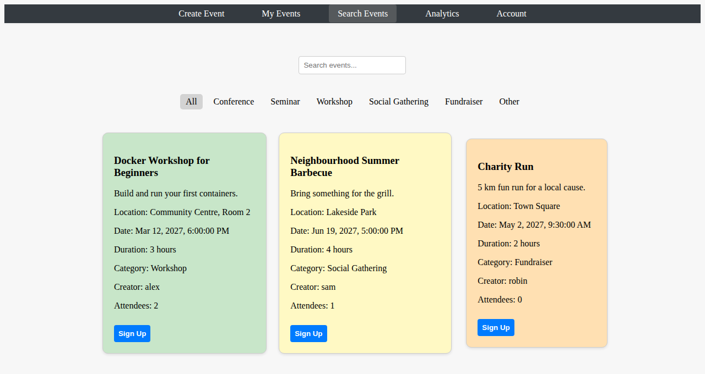
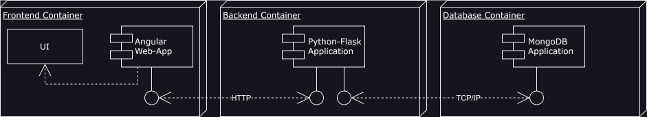

# EventManager, containerised

An event management web app (Angular, Flask, MongoDB) packaged as three Docker containers, with a Docker Swarm stack that runs the backend as three replicas.



## What and why

This was an individual school project during my apprenticeship (GIBZ, 2024). The assignment was to containerise an application: images, a custom network, a volume, resource limits, a non-root container user, and scaling with Docker Swarm.

The app was built in June 2024. The containerisation is the focus of this repo. I wrote the app earlier in two separate repositories (backend and frontend, now private) and copied it in here for this project. Users can register, create events, sign up for and leave events, search and filter them, and see simple statistics and charts.



| Container | Image | What it does |
|---|---|---|
| Frontend | `eventmanager/frontend:1.0`, multi-stage build (`node:22` → `nginx:alpine`) | nginx serves the Angular app and forwards `/api/` to the backend |
| Backend | `eventmanager/backend:1.0`, based on `python:3.12-slim` | Flask REST API on port 5000, runs as the non-root user `flaskuser` |
| Database | `eventmanager/mongodb:1.0`, based on `mongo:7.0` | MongoDB; `init-mongo.js` creates the collections, a unique index on `username` and a text index for search |

- **Network:** a custom bridge network (`eventmanager_network`) in Docker Compose, an overlay network in Swarm.
- **Ports (Compose):** frontend `4200 → 80`, backend `5000 → 5000`, MongoDB `127.0.0.1:27017 → 27017`.
- **Volume:** MongoDB data lives in the named volume `mongodb_data`. Compose prefixes it with the project name, for example `eventmanager-containerized_mongodb_data` (see `docker volume ls`).
- **Swarm stack** (`docker-compose-swarm.yaml`): three backend replicas, limited to 0.5 CPU and 512 MB each, restarted on failure, and updated two at a time with a 10-second delay.

## Result

The whole app starts with one `docker compose up`. I ran the Swarm stack with three backend replicas, tested it, and demonstrated it live when I presented the project.

When I prepared the repository for publication in November 2026, a clean run showed that login and search failed with HTTP 500. These problems, and two other issues with the setup, are fixed in separate commits after the tag [`v1.0`](https://github.com/daniel-bernet/eventManager-containerized/tree/v1.0), which marks the state I handed in:

- The backend gets `SECRET_KEY` from the environment, so login works.
- Search results are converted to JSON correctly.
- MongoDB, which runs without authentication, is published on `127.0.0.1` only (Compose) or not at all (Swarm).
- The Swarm stack uses the locally built images, including the custom MongoDB image, instead of images on Docker Hub.

The app itself is otherwise unchanged; see [Limitations](#limitations-and-status).

## How to run

You need Docker with the Compose plugin.

```bash
git clone https://github.com/daniel-bernet/eventManager-containerized.git
cd eventManager-containerized
docker compose up -d --build
```

Then open <http://localhost:4200>, register a user and create an event. Stop with `docker compose down`; add `--volumes` to delete the data as well.

Optional environment variables (in your shell or a `.env` file next to `docker-compose.yaml`):

| Variable | Default | Purpose |
|---|---|---|
| `SECRET_KEY` | `insecure-local-dev-key` | Flask session key. Set your own for anything beyond a local test. |
| `SYNCFUSION_LICENSE_KEY` | empty | Build argument for the frontend. Without a key the app works, but Syncfusion shows a licence banner. |

### Docker Swarm

The Swarm stack uses the images that Compose builds, so build them first. Locally built images only work on a single-node swarm; with several nodes, push them to a registry first.

```bash
docker compose build
docker swarm init
docker stack deploy -c docker-compose-swarm.yaml eventmanager_stack
docker service ps eventmanager_stack_backend    # the three backend replicas
```

- Scale: `docker service scale eventmanager_stack_backend=5`
- Rolling update: build a new backend image, change its tag in `docker-compose-swarm.yaml`, and run the same `docker stack deploy` command again. Swarm replaces two replicas at a time, 10 seconds apart.
- Logs of all replicas: `docker service logs eventmanager_stack_backend`
- Remove: `docker stack rm eventmanager_stack`, then `docker swarm leave --force`

### Other useful commands

- Resource usage: `docker stats`
- Container logs through the Docker Engine API, without exposing it on a TCP port:

  ```bash
  curl --unix-socket /var/run/docker.sock "http://localhost/containers/eventmanager_backend/logs?stdout=1&stderr=1" --output -
  ```

- Vulnerability scan (recommended, not part of the project): `trivy image eventmanager/backend:1.0`

## Limitations and status

Status: completed in September 2024 as a school project. The fixes listed above were added in November 2026; nothing else was developed further.

The app was written as an exercise, not for real use:

- **No authorisation.** The frontend sends the user ID with each request and the backend trusts it. Anyone can delete any event.
- **Deleting an account fails.** The transaction is started on a second MongoDB client, which PyMongo rejects. Transactions also need a replica set, and the setup runs a single standalone MongoDB server.
- **No update endpoint.** Events can be created and deleted, but not edited.
- **The frontend test is outdated.** `app.component.spec.ts` still expects the Angular starter page, so `ng test` fails.
- **Hardcoded database names.** The backend always uses the database `your_database_name`; the database name in `MONGO_URI` is ignored.
- The login state is kept only in the browser's memory, so reloading the page logs you out.
- The backend runs Flask's built-in development server.

## Licence

- Code: [MIT](LICENSE)
- This README and the diagram: [CC BY 4.0](https://creativecommons.org/licenses/by/4.0/)

## Credits

Third-party software is installed through npm, pip or the Docker base images; none of it is included in this repository. It keeps its own licence:

- [Angular](https://angular.dev) (MIT)
- [Syncfusion Essential JS 2 Charts](https://www.syncfusion.com/angular-components/angular-charts): Syncfusion community or commercial licence; using it requires one of them
- [Flask](https://flask.palletsprojects.com), [Flask-Cors](https://github.com/corydolphin/flask-cors) and [PyMongo](https://pymongo.readthedocs.io)
- [MongoDB](https://www.mongodb.com), [nginx](https://nginx.org), [Node.js](https://nodejs.org) and [Python](https://www.python.org) official Docker images

---

Project page: <https://dbernet.ch/projects/>
